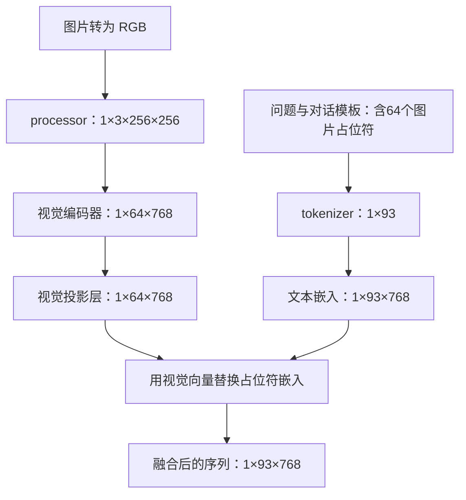

# MiniMind-V 源码阅读与多模态推理流程理解

本项目记录我在本地运行 MiniMind-V 后，围绕推理代码进行阅读、添加代码注释，并理解模型从输入图片和问题到生成回答的过程。**重点是第二阶段的代码注释，以及图文融合、模型前向和自回归生成机制的理解。**

## 第一阶段：在本机运行模型

按照 [MiniMind-V 上游项目](https://github.com/jingyaogong/minimind-v)的推理流程，准备配套环境，下载模型和视觉编码器，加载匹配权重与 tokenizer，最终在 RTX 5060 Laptop GPU（8GB）上成功完成图片识别并输出文字回答。使用的是上游已有权重，未进行训练。具体步骤见[复现说明](docs/reproduction.md)，实际输出见[单图运行记录](results/evidence/m1-single-image.txt)。

## 第二阶段：阅读代码、添加注释，理解模型如何运转

在能够运行模型后，我沿着实际调用路径阅读代码，对图片预处理、文本编码、图文融合和模型前向等位置添加中文注释，再向下追踪父类中的生成循环。学习内容按两条主线组织：**图片如何转为张量并与文本融合，以及模型如何处理融合后的序列并生成文字。**

建议先看以下两份材料：

- **[代码注释与完整函数快照](docs/annotated-code.md)**：按源文件列出中文注释位置，保留 9 个完整代码单元，可直接对照实现阅读。
- **[模型运转过程详解](docs/inference-path.md)**：把注释串成完整推理流程，说明各模块的输入、输出、作用和调用关系，并澄清学习中容易混淆的概念。

### 主线一：图片如何进入语言模型

| 代码位置 | 阅读和注释的重点 | 对模型运转的理解 |
| --- | --- | --- |
| `eval_vlm.py / init_model` | 模型、权重、tokenizer 和 processor 的加载关系 | 模型代码定义结构；加载权重后才得到本次推理使用的模型，视觉编码器另有配套资源 |
| `eval_vlm.py / main` | RGB 转换、`image2tensor`、字典推导式与 `.to(device)` | 图片经 processor 转成张量，再移到 GPU；返回的字典与字典中的张量需要区分 |
| `eval_vlm.py / main` | `messages`、图片占位符、对话模板和 tokenizer | 先为图片预留 64 个位置；模板生成字符串，tokenizer 再将字符串编码为 token ID |
| `model_vlm.py / forward` | 文本嵌入、视觉编码、`vision_proj` | 文本 ID 查表得到嵌入；图片经视觉编码器提取特征，再通过投影层变换表示 |
| `model_vlm.py / count_vision_proj` | 图片占位符区间与视觉特征替换 | 视觉向量替换预留位置的嵌入，与周围文本共同组成语言模型输入 |

这里最关键的是：**图像内容不是直接作为像素送进语言模型，也不是在文本末尾额外追加 64 个位置，而是用视觉特征替换已经预留的占位符嵌入。**



本次视觉和文本隐藏维度都是 768，但投影层仍有变换特征表示的作用，不能因为维度相同就认为可以省略它。`vision_proj` 的输入本来已经是张量，它也不是图片首次转为张量的位置。

### 主线二：模型如何处理序列并生成回答

生成流程需要跨文件追踪，而不是只看入口处的 `model.generate(...)`：

```text
eval_vlm.py 或 trace_vlm_shapes.py 调用 model.generate
  → model_vlm.py：MiniMindVLM.generate
  → model_minimind.py：MiniMindForCausalLM.generate
  → 循环调用实际实例的 MiniMindVLM.forward
  → 选择新 token、追加到序列、更新缓存，直到停止
```

| 代码位置 | 阅读重点 | 对模型运转的理解 |
| --- | --- | --- |
| `model_vlm.py / forward` | 融合后的隐藏状态、位置编码、Transformer 层与 `presents` | 8 层 Transformer 处理融合序列，每层返回新的隐藏状态与本层 K/V 缓存 |
| `model_vlm.py / forward` | 最后归一化与 `lm_head` | 将隐藏表示映射到词表分数 logits；logits 本身不是概率 |
| `model_minimind.py / generate` | `outputs.logits[:, -1, :]` 与 token 选择 | 取最后位置的分数预测下一个 token；采样与贪心是不同的选择方式 |
| `model_minimind.py / generate` | `input_ids[:, past_len:]` 与 `past_key_values` | 有缓存时只把尚未处理的新 token 送入下一次前向，复用旧位置的 K/V |
| 生成循环与 tokenizer | EOS、长度上限和 `decode` | 返回序列包含提示与新 token；截去提示部分后才解码为本次回答 |

`model_minimind.py` 的生成循环是继续追踪阅读的上游实现，没有本地注释改动；已有中文注释主要集中在 `eval_vlm.py` 和 `model_vlm.py`。完整摘录和注释位置见[代码记录](docs/annotated-code.md)。

### 结合运行记录核对理解

为核对上述源码分析，运行形状采集脚本，观察前两次前向中的张量形状和缓存长度。采集使用 seed=42、贪心生成、KV cache，最多生成 2 个新 token。

| 观察位置 | 首次前向 | 第二次前向 |
| --- | --- | --- |
| 本次输入长度 / 已缓存长度 | 93 / 0 | 1 / 93 |
| 视觉编码输出 | `[1,64,768]` | 未再次执行 |
| 视觉投影输出 | `[1,64,768]` | 未再次执行 |
| 第一层 Transformer 输入 | `[1,93,768]` | `[1,1,768]` |
| logits | `[1,93,6400]` | `[1,1,6400]` |

由此将代码阅读与实际运行对应起来：

1. **融合后序列长度不增加。** 本次输入共 93 个位置，其中 64 个是图片占位符，其余 29 个包括问题和模板标记；替换后仍为 93 个位置。形状记录验证长度，具体替换机制由源码确认。
2. **缓存保存的是各层 K/V。** 首次处理 93 个位置后，第二次只输入第一个新 token，复用已有 93 个位置的缓存，仍能利用前文的图片和问题信息。
3. **启用缓存时，图片不在每一步重新编码。** 本次第二次前向没有再次触发视觉编码、投影和融合，对应源码中的 `start_pos == 0` 条件。

记录中的新 token ID 为 `[394,2370]`，解码为“这张”，达到 2 token 上限后停止；这次运行用于观察生成机制，不是完整图片问答测试。

- [形状采集脚本](scripts/trace_vlm_shapes.py)
- [实际采集记录](results/evidence/m2-shapes.json)
- [观察时的教学注释补丁](patches/m2-observed-comments.patch)

## 版本、来源与工作范围

对应上游提交 `041d528e037a8a373c3c8aa7278a3ba3bd26b6dc`。已验证环境为 Windows 11、RTX 5060 Laptop、Python 3.12.14、PyTorch 2.13.0+cu130、Transformers 4.57.6，推理采用 CUDA FP16。环境与资源获取方法见[复现说明](docs/reproduction.md)。

模型结构、推理实现与权重来自上游。本人参与运行、代码阅读、中文注释和流程理解；AI 助手辅助脚本编写、解释、排错与整理，注释在学习过程中共同补充，不将所有代码和注释宣称为本人独立编写。注释中的部分早期表述保留原文，并在[流程详解](docs/inference-path.md)中澄清。

当前展示范围为本地运行与源码理解，尚未完成训练、正式批量评测或性能对照。更多信息见[工作分工与证据索引](docs/contributions.md)、[结果与排错分析](docs/findings.md)和[来源许可说明](THIRD_PARTY_NOTICES.md)。公开证据仅做路径脱敏和编码规范化，变换及哈希见 [provenance.json](results/evidence/provenance.json)。
