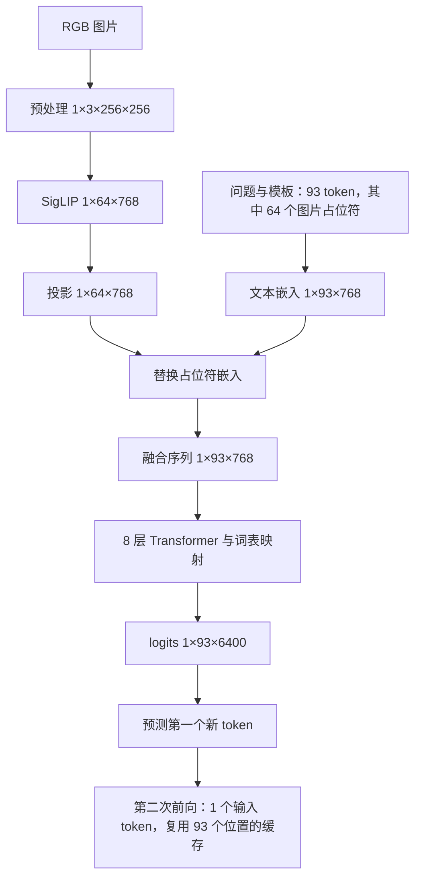

# MiniMind-V 本地推理复现与多模态生成流程分析

在 RTX 5060 Laptop GPU（8GB）上复现固定版本 MiniMind-V 的图片问答，并通过运行时观察，分析**图像如何进入语言模型、模型如何利用 KV cache 逐 token 生成文本**。

已完成本地推理链路验证、真实错误排查和关键张量形状采集。使用上游已有权重，未训练或微调；完整小规模评测与性能对照尚未完成。主要实证采集于 2026-11-13。

## 快速浏览

- [复现方法与环境](docs/reproduction.md)：固定代码、模型资源及运行命令。
- [推理路径分析](docs/inference-path.md)：图片与文本融合、首次前向、生成循环及缓存。
- [代码注释与完整函数快照](docs/annotated-code.md)：可对照源码阅读，附原注释歧义澄清。
- [真实排错与结果分析](docs/findings.md)：成功运行之外，记录模型回答的问题和测量边界。
- [工作分工与证据索引](docs/contributions.md)：上游、本人参与与 AI 辅助的范围。

## 第一阶段：在本机跑通图片问答

检查现有环境，完成 CUDA 矩阵运算验证；建立隔离环境，固定上游提交与匹配资源。定位 Python GBK 输出异常和 PowerShell 管道乱码，最终在新进程中完成单图生成。

输入来自上游固定提交的金毛犬与气球样例。图片原始摄影/生成来源未独立核验，不作为独立测试集，也不在本仓库重新打包分发。

问题：`请描述这张图中的主要物体和场景。`

真实回答（原文保留）：

> 这张图片中的主要物体是金色的金色狗。狗是一只金毛寻回犬，以其金色的色调和可爱的表情而闻名。它们正在用双臂举起，身体朝前，展现出轻松和快乐的态度。狗身上装饰

识别到金毛犬，但“用双臂举起”不符合画面，遗漏气球、草地与蓝天，存在重复及未完成句子。该次没有保存实际生成长度和结束原因，不能确定结尾未完成是否由 64 token 上限造成。[原始输出公开副本](results/evidence/m1-single-image.txt)

## 第二阶段：用实测形状理解推理路径

使用临时 hook 和函数包装记录形状、dtype、device、输入长度与缓存长度；观察后恢复模型。固定 seed=42、贪心、KV cache，最多生成 2 token，用于观察前两次前向，不用于评价问答质量。[原始形状记录公开副本](results/evidence/m2-shapes.json)

| 观察点 | 首次前向 | 第二次前向 |
| --- | --- | --- |
| 输入长度 / 已缓存长度 | 93 / 0 | 1 / 93 |
| 视觉编码与投影输出 | `[1,64,768]` | 未再次执行 |
| 第一层输入 | `[1,93,768]` | `[1,1,768]` |
| logits | `[1,93,6400]` | `[1,1,6400]` |

由源码与记录一起确认：64 个视觉向量**替换**预留的 64 个位置，融合后仍为 93 个位置；启用缓存后第二次前向只处理新增 token，不再次执行视觉编码。形状相同本身不能证明数值替换，替换机制依据源码分析。

新增 token ID 为 `[394,2370]`，解码为“这张”，因 2 token 上限停止。这是流程观察，不是完整图片描述。

## 环境与版本

| 项目 | 实际记录 |
| --- | --- |
| 系统 / GPU | Windows 11 / RTX 5060 Laptop，8151 MiB 显存 |
| Python / PyTorch | 3.12.14 / 2.13.0+cu130 |
| CUDA / Transformers | PyTorch 构建 CUDA 13.0 / 4.57.6 |
| 推理配置 | dense，hidden=768，8 层，CUDA FP16，batch=1 |
| 上游代码 | [jingyaogong/minimind-v](https://github.com/jingyaogong/minimind-v)，提交 `041d528e037a8a373c3c8aa7278a3ba3bd26b6dc` |

驱动显示的 CUDA 13.1 与 PyTorch 构建版本不是同一概念。这里报告已验证环境，不保证其他设备安装同样版本即可复现。

## 本项目增加了什么

本人亲自执行环境与关键推理命令、反馈真实错误、阅读和讨论上游代码、参与中文注释并理解图文融合及生成路径。本项目增加 GPU 检查、形状观察入口、证据归档和流程解释；脚本编写、排错和文档整理有 AI 助手辅助，不将所有代码或注释宣称为本人独立编写。模型结构、训练方法与预训练权重来自上游。

## 复现与边界

从[复现说明](docs/reproduction.md)开始：准备隔离环境 → 获取固定上游与匹配资源 → GPU 检查 → 单图推理 → 两步形状采集。代码、模型权重与 tokenizer 需要匹配；本仓库不包含权重或环境。

M1 使用未记录随机种子的采样，不保证逐字复现；M2 使用贪心与固定种子，也不承诺跨设备逐字一致。日志中的 `49.15 tokens/s` 未经规范同步、预热和重复测量，不作为性能成果；`65.09M` 是上游默认排除视觉编码器的统计。未完成正式准确率评测、资源开销对照、训练、量化或端侧移植。

公开证据仅做机器路径脱敏和编码/换行规范化，原始回答与实测数字保留。转换范围及前后 SHA256 见 [provenance.json](results/evidence/provenance.json)。许可与来源见 [THIRD_PARTY_NOTICES.md](THIRD_PARTY_NOTICES.md)。
