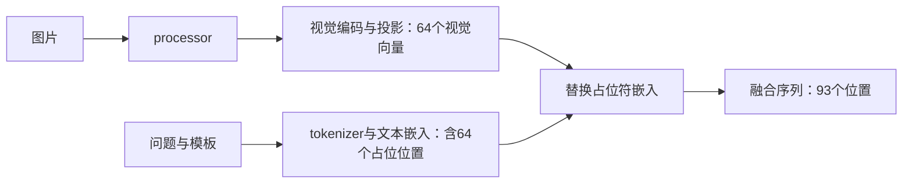

# MiniMind-V 源码阅读与多模态推理流程理解

本项目记录我在本地运行 MiniMind-V 后，围绕推理代码进行阅读、添加代码注释，并理解模型从输入图片和问题到生成回答的过程。**重点是第二阶段的代码注释，以及图文融合、模型前向和自回归生成机制的理解。**

## 第一阶段：在本机运行模型

按照 [MiniMind-V 上游项目](https://github.com/jingyaogong/minimind-v)的推理流程，准备配套环境，下载模型和视觉编码器，加载匹配权重与 tokenizer，最终在 RTX 5060 Laptop GPU（8GB）上成功完成图片识别并输出文字回答。使用的是上游已有权重，未进行训练。具体步骤见[复现说明](docs/reproduction.md)，实际输出见[单图运行记录](results/evidence/m1-single-image.txt)。

## 第二阶段：阅读代码、添加注释，理解模型如何运转

在能够运行模型后，我沿着实际调用路径阅读代码，重点理解了图片预处理（转变为张量的过程）、文本编码、图文融合（图片张量和文张量合并）和模型的前向传播，并深入研究了 MiniMindForCausalLM 类中的生成循环。详细过程见[流程记录](docs/inference-path.md)。

### 第一部分：图片转为张量，并与文本融合

#### 1. 读取图片，转为模型输入张量

来源：`eval_vlm.py / main`、`model_vlm.py / image2tensor`。

```python
# 统一为 RGB 三通道，随后交给与视觉编码器配套的 processor。
image = Image.open(image_path).convert('RGB')

pixel_values = {
    # k 是字典键，v 是对应的张量；将张量移到模型所在设备。
    k: v.to(args.device)
    for k, v in MiniMindVLM.image2tensor(image, preprocess).items()
}
```

`image2tensor` 内部实际调用 processor：

```python
inputs = processor(images=image, return_tensors="pt")
return inputs
```

这一步已经把图片转为张量。本次原图为 640×640，预处理后的 `pixel_values` 张量为 **`[1,3,256,256]`**，各轴分别是 batch、通道、高、宽。`pixel_values` 这个变量本身是包含张量的字典；`.to(args.device)` 用于迁移设备，没有在此显式指定 dtype。

#### 2. 处理问题，为图片预留位置，再编码文本

来源：`eval_vlm.py / main`。

```python
prompt = "<image>\n请描述这张图中的主要物体和场景。"
messages = [
    {
        "role": "user",
        # 将 <image> 替换成 64 个连续的图片占位符。
        # 此时只是预留位置，还没有把图片内容写入文本。
        "content": prompt.replace(
            '<image>',
            model.config.image_special_token * model.config.image_token_len
        )
    }
]

# tokenize=False：先生成包含角色和边界标记的对话字符串。
inputs_text = tokenizer.apply_chat_template(
    messages, tokenize=False, add_generation_prompt=True,
    open_thinking=bool(args.open_thinking)
)

# tokenizer 再把字符串编码成 token ID 和 attention mask，并移到 GPU。
inputs = tokenizer(
    inputs_text, return_tensors="pt", truncation=True
).to(args.device)
```

本次文本 ID 为 **`[1,93]`**，其中有 64 个 ID 为 12 的图片占位符，其余 29 个位置包括问题和模板标记。这里的 `messages` 是本地对话模板输入，不代表向外部接口发送请求。

#### 3. 分别得到文本嵌入和视觉特征

来源：`model_vlm.py / forward`。下面摘取本次单图路径，省略多图等其他分支。

```python
# 文本 token ID 查嵌入表：[1,93] → [1,93,768]。
# 此时图片位置仍然只是占位符的普通嵌入。
hidden_states = self.model.dropout(self.model.embed_tokens(input_ids))

# start_pos 是已有缓存的长度。
# 首次前向没有旧缓存，才执行图片编码与融合。
if pixel_values is not None and start_pos == 0:
    # get_image_embeddings：视觉编码器输出 [1,64,768]。
    # vision_proj：LayerNorm → Linear → GELU → Linear，变换特征表示。
    vision_tensors = self.vision_proj(
        MiniMindVLM.get_image_embeddings(pixel_values, self.vision_encoder)
    )

    # 用视觉特征替换对应位置的占位符嵌入。
    hidden_states = self.count_vision_proj(
        tokens=input_ids,
        h=hidden_states,
        vision_tensors=vision_tensors,
        seqlen=input_ids.shape[1]
    )
```

`get_image_embeddings` 在 `torch.no_grad()` 中调用视觉编码器，返回 `last_hidden_state`。本版本图片大小为 256×256、patch 为 32×32，对应 8×8=64 个位置。视觉编码器输出 **`[1,64,768]`**，投影后形状相同，但表示内容经过了变换；投影不是图片首次转为张量的位置。

#### 4. 找到占位符区间，替换对应嵌入

来源：`model_vlm.py / count_vision_proj`，摘录替换区间的关键语句；外层循环、图片数量轴处理及越界条件见完整函数。

```python
# seq 是当前样本的 token ID 列表，marker 是图片占位符 ID。
if seq[i] == marker:
    start = i
    # 找到连续占位符区间 [start, i)。
    while i < len(seq) and seq[i] == marker:
        i += 1
    if k < vf.size(1):
        # hb[:start]：保留图片位置之前的文本嵌入。
        # vf[b][k][:i-start]：取当前图片对应的视觉向量。
        # hb[i:]：保留图片位置之后的文本嵌入。
        hb = torch.cat(
            (hb[:start], vf[b][k][:i - start], hb[i:]), dim=0
        )[:seqlen]
        k += 1
```

**图文融合在这里体现为嵌入替换，而不是把图片特征额外追加到文本末尾。** 本次 64 个视觉向量替换 64 个预留位置，融合前后都是 **`[1,93,768]`**，不会变成 157 个位置。形状记录验证长度，替换机制则由这段源码确认。



### 主线二：模型如何处理融合序列，并生成文字

#### 5. 经过 Transformer，再映射为词表分数

来源：`model_vlm.py / forward`，摘录层循环、归一化和词表映射，省略位置编码准备及训练损失等处理。

```python
# presents 收集每一层本次返回的 K/V 缓存。
presents = []
for layer_idx, (layer, past_key_value) in enumerate(
    zip(self.model.layers, past_key_values)
):
    # layer 实际为 MiniMindBlock。
    # 本层读取隐藏状态与旧缓存，返回新隐藏状态和本层缓存。
    hidden_states, present = layer(
        hidden_states,
        position_embeddings,
        past_key_value=past_key_value,
        use_cache=use_cache,
        attention_mask=attention_mask
    )
    presents.append(present)

hidden_states = self.model.norm(hidden_states)

# 本次 logits_to_keep=0，保留所有输入位置的输出。
slice_indices = (
    slice(-logits_to_keep, None)
    if isinstance(logits_to_keep, int) else logits_to_keep
)
# 每个位置的 768 维隐藏表示，映射为 6400 个词表分数。
logits = self.lm_head(hidden_states[:, slice_indices, :])
```

融合后的序列经过 8 层 Transformer，首次输出 logits 为 **`[1,93,6400]`**。logits 是未归一化的分数；各层 `present` 汇总为 `presents`，通过 forward 返回值的 `past_key_values` 字段交给生成循环。

#### 6. 追踪生成循环，理解为什么第二次只输入一个 token

实际调用关系是：

```text
model.generate
  → MiniMindVLM.generate
  → 父类 MiniMindForCausalLM.generate
  → self.forward（实际为 MiniMindVLM.forward）
```

来源：`model_minimind.py / MiniMindForCausalLM.generate`。下面是循环中的关键语句，按执行顺序摘录；省略采样筛选、重复惩罚、attention mask 更新、已结束样本处理和流式显示等逻辑，完整实现见附录。

```python
for _ in range(max_new_tokens):
    # 读取旧缓存长度；首次为 0，第二次为 93。
    past_len = past_key_values[0][0].shape[1] if past_key_values else 0

    # 只传入尚未进入缓存的 token。
    # 首次传完整的 93 个位置，第二次只传刚生成的 1 个 token。
    outputs = self.forward(
        input_ids[:, past_len:], attention_mask, past_key_values,
        use_cache=use_cache, **kwargs
    )

    # 只用最后一个位置的分数预测下一个 token。
    logits = outputs.logits[:, -1, :] / temperature

    # 原实现此处还包含重复惩罚、top-k、top-p 等分数处理（此处省略）。
    # do_sample=True 时采样，False 时取最大分数的 token。
    next_token = (
        torch.multinomial(torch.softmax(logits, dim=-1), num_samples=1)
        if do_sample else torch.argmax(logits, dim=-1, keepdim=True)
    )

    # 将新 token 追加到完整序列。
    input_ids = torch.cat([input_ids, next_token], dim=-1)
    # 保存本次前向得到的缓存，供下一轮使用。
    past_key_values = outputs.past_key_values if use_cache else None

    # 若所有样本都生成 EOS，则提前停止；否则最多执行 max_new_tokens 轮。
    if eos_token_id is not None:
        finished |= next_token.squeeze(-1).eq(eos_token_id)
        if finished.all():
            break
```

这里需要区分**预测一个 token**与**将这个 token 输入下一次前向**：首次前向处理 93 个位置，预测 ID 394，此时缓存覆盖的是原有 93 个位置；第二次才把 394 送入模型，利用旧缓存预测 ID 2370。

缓存保存各层 K/V，不是原始图片或最终文字。第二次前向虽然只输入一个 token，仍能通过注意力利用缓存中的图文上下文；同时 `start_pos` 不再为 0，因而不重复执行视觉编码和投影。这一结论对应本次 `use_cache=True` 的设置。

父类生成循环原来没有本地注释改动，上面为在 README 中展示阅读理解而补充的解释性注释；已有源文件注释主要位于 `eval_vlm.py` 和 `model_vlm.py`。

#### 7. 去掉提示部分，将新 token 解码为文字

来源：`scripts/trace_vlm_shapes.py`。

```python
# generate 返回的序列包含原始提示，先切掉这部分。
new_ids = generated[0, inputs.input_ids.shape[1]:].tolist()
# 只解码新生成的 ID，跳过特殊标记。
tokenizer.decode(new_ids, skip_special_tokens=True)
```

本次新 ID 为 `[394,2370]`，解码得到“这张”；达到 2 token 上限后停止。一个 token 不保证对应一个汉字，这次也不是完整图片问答测试。

### 用实际运行记录核对代码理解

运行[形状采集脚本](scripts/trace_vlm_shapes.py)，以 seed=42、贪心生成和 KV cache 观察前两次前向，得到：

| 观察位置 | 首次前向 | 第二次前向 |
| --- | --- | --- |
| 本次输入长度 / 已缓存长度 | 93 / 0 | 1 / 93 |
| 视觉编码输出 | `[1,64,768]` | 未再次执行 |
| 视觉投影输出 | `[1,64,768]` | 未再次执行 |
| 第一层 Transformer 输入 | `[1,93,768]` | `[1,1,768]` |
| logits | `[1,93,6400]` | `[1,1,6400]` |

这些记录分别对应前面的**占位符替换、各层前向传播和缓存复用**。原始记录及观察时的源码差异见[实际采集记录](results/evidence/m2-shapes.json)与[教学注释补丁](patches/m2-observed-comments.patch)。

## 版本、来源与工作范围

对应上游提交 `041d528e037a8a373c3c8aa7278a3ba3bd26b6dc`。已验证环境为 Windows 11、RTX 5060 Laptop、Python 3.12.14、PyTorch 2.13.0+cu130、Transformers 4.57.6，推理采用 CUDA FP16。环境与资源获取方法见[复现说明](docs/reproduction.md)。

模型结构、推理实现与权重来自上游。本人参与运行、代码阅读、中文注释和流程理解；AI 助手辅助脚本编写、解释、排错与整理，注释在学习过程中共同补充，不将所有代码和注释宣称为本人独立编写。注释中的部分早期表述保留原文，并在[流程详解](docs/inference-path.md)中澄清。

当前展示范围为本地运行与源码理解，尚未完成训练、正式批量评测或性能对照。更多信息见[工作分工与证据索引](docs/contributions.md)、[结果与排错分析](docs/findings.md)和[来源许可说明](THIRD_PARTY_NOTICES.md)。公开证据仅做路径脱敏和编码规范化，变换及哈希见 [provenance.json](results/evidence/provenance.json)。
