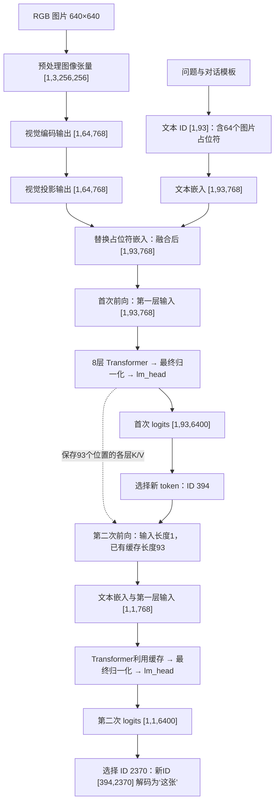

# MiniMind-V 源码阅读与多模态推理流程理解

本项目记录我在本地运行 MiniMind-V 后，围绕推理代码进行阅读、添加代码注释，并理解模型从输入图片和问题到生成回答的过程。

## 第一阶段：在本机运行模型

按照 [MiniMind-V 上游项目](https://github.com/jingyaogong/minimind-v)的推理流程，准备配套环境，下载模型和视觉编码器，加载匹配权重与 tokenizer，最终在 RTX 5060 Laptop GPU（8GB）上成功完成图片识别并输出文字回答。使用的是上游已有权重，未进行训练。具体步骤见[复现说明](docs/reproduction.md)，实际输出见[单图运行记录](results/evidence/m1-single-image.txt)。

## 第二阶段：阅读代码、添加注释，理解模型如何运转

在能够运行模型后，我沿着实际调用路径阅读代码，重点理解了图片预处理（转变为张量的过程）、文本编码、图文融合（图片张量和文字张量合并）和模型的前向传播，并深入研究了 MiniMindForCausalLM 类中的生成循环。以下是我对文件中一些代码的注释。更详细的过程见[流程记录](docs/inference-path.md)。

### 第一部分：图片转为张量，并与文本融合

#### 1. 读取图片，转为模型输入张量

```python
# 读取图片并统一为 RGB 三通道，以匹配视觉编码器输入
image_path = os.path.join(args.image_dir, image_file)
image = Image.open(image_path).convert('RGB')

# 将图片预处理为张量，并移动到模型所在设备（如 GPU）。
pixel_values = {
     # k 是键, v 是值(张量)，v.to(args.device) 将张量移动到指定设备（如 GPU 或 CPU）。
     # 移到模型所在设备
     k: v.to(args.device)
     # 调用 MiniMindVLM.image2tensor 方法，将图像和预处理器传入，返回一个字典，包含图像张量 v
     for k, v in MiniMindVLM.image2tensor(image, preprocess).items()
}
```

这一步已经把图片转为张量。`pixel_values` 是包含张量的字典，其中图像张量为 **`[1,3,256,256]`**，各维分别是 batch、通道、高、宽。

#### 2. 生成 messages :

来源：`eval_vlm.py / main`。

```python
prompt = "<image>\n请描述这张图中的主要物体和场景。"
# messages 是对话消息列表，遵循 OpenAI 接口，有以下格式：
# messages = [
#    {"role": "user", "content": "..."}
#]
messages = [
    # <image> 是占位符，表示图像位置
    # 一共拼接 64 个占位符
    {"role": "user", "content": 
          prompt.replace('<image>',model.config.image_special_token * model.config.image_token_len)
    }
]
```

#### 进行文本分词：

得到 `messages` 后，调用分词器 `tokenizer` 将 `messages` 编码为 token ID ，并转化为 Pytorch 张量 `inputs` 

```python
inputs_text = tokenizer.apply_chat_template(messages, tokenize=False, add_generation_prompt=True, open_thinking=bool(args.open_thinking))
inputs = tokenizer(inputs_text, return_tensors="pt", truncation=True).to(args.device)
```

#### 与文字张量融合：

在 `model_vlm.py` 中，`hidden_states` 开始时是词嵌入向量，但包含了 64 个用于占位、尚未包含图像内容的嵌入向量

随后在如下代码作用下完成对 `vision_tensors` （视觉向量）和 `hidden_states` （词嵌入向量）的合并

```python
# pixel_values is not None 表示输入中包含图像张量
# start_pos == 0 表示这是序列的开头
if pixel_values is not None and start_pos == 0:
    if hasattr(pixel_values, 'keys'):
        sample_val = next(iter(pixel_values.values()))
        # 如果 sample_val 的维度是 5，对应多图输入（增加的是图片数量轴 num_images）
        if sample_val.ndim == 5:
            bs, num = sample_val.shape[:2]
            ...
        # 代表单个图片，有四个维度
        else:
            # get_image_embeddings(...)：用 SigLIP 视觉编码器提取图片特征
            # vision_proj(...)：经过 LayerNorm → Linear → GELU → Linear，变换已有视觉特征，使其适配语言模型
            vision_tensors = self.vision_proj(
                MiniMindVLM.get_image_embeddings(pixel_values, self.vision_encoder)
            )
    else:
        ...
    # 替换前：[对话前缀嵌入][64 个占位符嵌入][问题嵌入]
    # 替换后：[对话前缀嵌入][64 个视觉向量  ][问题嵌入]
    hidden_states = self.count_vision_proj(
        tokens=input_ids, 
        h=hidden_states, 
        vision_tensors=vision_tensors, 
        seqlen=input_ids.shape[1]
    )
```


### 第二部分：模型处理融合向量，并生成文字

这部分内容就是传统的 gpt 风格的 Transformer 架构了。

融合后的序列进入语言模型，大致按以下顺序完成一次前向传播与生成：

1. **归一化**：每个 Transformer 层先对输入做 RMSNorm，再送入注意力模块。
2. **注意力计算**：从隐藏状态计算 Q、K、V，对 Q、K 应用 RoPE 位置编码，再进行因果注意力计算，使当前位置利用可见的图文上下文；启用缓存时复用旧位置的 K、V。
3. **残差连接**：将注意力输出与该层输入相加，保留原有信息。
4. **前馈网络**：再做一次 RMSNorm，经过门控前馈网络，并与残差相加。上述过程依次经过本模型的 8 层 Transformer。
5. **最终归一化与词表映射**：经过最后的 RMSNorm，再由 `lm_head` 将每个位置的 768 维表示映射为 6400 个词表分数（logits）。
6. **选择下一个 token**：取最后一个位置的 logits；本次追踪使用贪心生成，选择分数最大的 token ID，并追加到输入序列。
7. **继续生成与解码**：保存本轮各层 K/V，下一轮只处理未缓存的新 token；遇到 EOS 或达到生成上限时停止，去掉原始提示部分，再将新 token 解码为文字。

### 第二阶段实际追踪到的张量

我还进行了模型推理过程中的张量形状追踪，记录了图片预处理、视觉编码、图文融合以及前两次前向传播中的关键张量，并将它们在源码中的连接关系整理为了下图。



## 发现的问题

在查看模型对图片的回答时，我发现模型虽然能够识别部分图像内容，但生成回答仍存在以下问题：

1. **识别主要物体后，仍会补充错误细节。** 对金毛犬图片，模型正确识别出金毛寻回犬，因此我认为核心回答总体正确；但它随后描述“尾巴是蓝色”，与图片不符。
2. **语言重复，解释缺乏逻辑。** 同一条回答中出现“金毛寻回犬通常被认为是宠物，因为它们通常被认为是宠物”，重复结论而没有给出有效原因。
3. **场景描述不完整，并生成无图像依据的解释。** 对雨伞街景，模型提到了地面湿润，但没有明确回答周围是街道，还编造了伞用于过滤雨水、防止雨水渗透地面的作用，内容也有明显重复。
